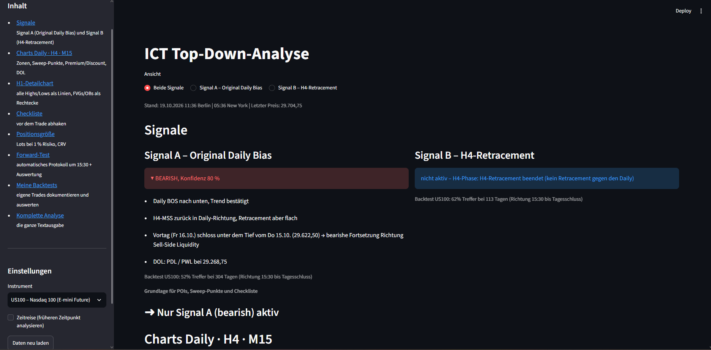
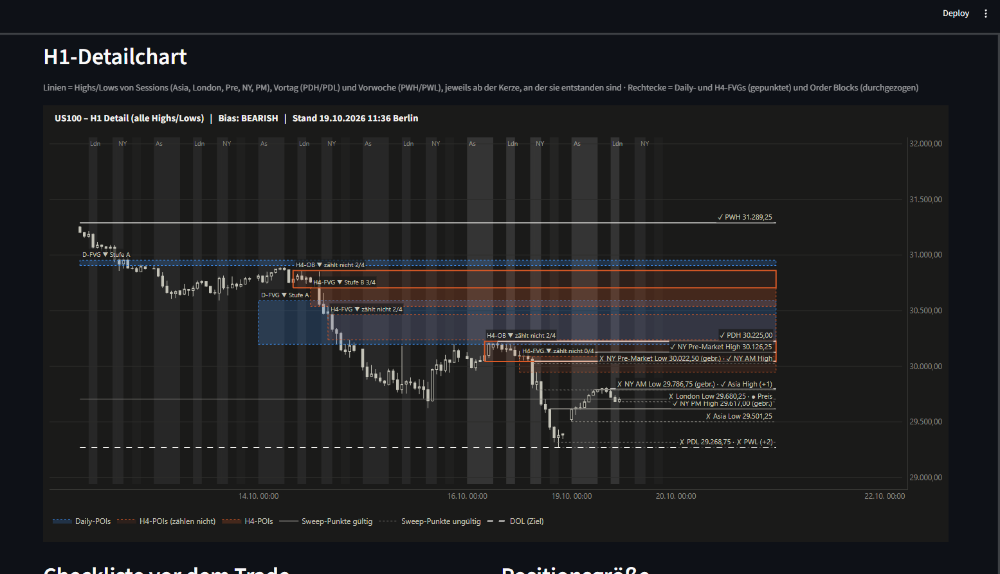
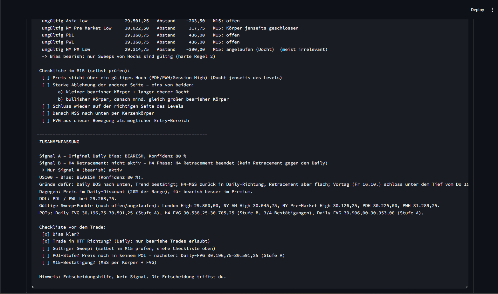
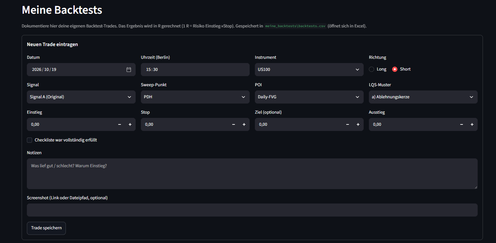

# ICT Top-Down Analysis Tool

A Python tool that automates a multi-timeframe market analysis (Daily → H4 → M15) based on
ICT concepts (Inner Circle Trader). It downloads price data, rebuilds candles with correct
session boundaries, detects market structure, liquidity levels and points of interest, and
presents everything in a **Streamlit web dashboard** with interactive **Plotly** charts.

> **Decision support, not a signal service.** The tool explains *why* it reaches a bias
> (every point of the confidence score is traceable) – the final decision stays with the user.
> Not financial advice.

🇩🇪 Deutsche Kurzfassung: siehe unten · Full German user guide: [README.de.md](README.de.md)



## Screenshots

**H1 detail chart** – session/day/week highs & lows, Fair Value Gaps and Order Blocks, draw on liquidity



**Full text analysis** – sweep points, pre-trade checklist and summary



**Trade log** – document your own backtest trades, results calculated in R



## Features

- **Data pipeline** – loads H1/M15 data from Yahoo Finance (`yfinance`) or any CSV export
  (auto-detects separator, German number/date formats, Unix timestamps, time zones)
- **Custom candle building** – H4, Daily and Weekly candles rebuilt in New York time with
  instrument-specific day boundaries (e.g. 18:00–17:00 NY for Nasdaq futures), weekend bars removed
- **Market structure** – swing detection, BOS/MSS confirmed by candle body only, protected
  highs/lows, equilibrium, premium/discount zones
- **Daily bias engine** – rule-based confidence score with human-readable reasons;
  returns *NEUTRAL* when criteria contradict each other
- **Points of interest** – Fair Value Gaps and Order Blocks with displacement and mitigation tracking
- **Liquidity & sessions** – previous day/week highs & lows, Asia/London/NY session ranges,
  sweep watch list, Power of 3
- **"Time travel" mode** – `--asof` replays any past moment without look-ahead bias
- **Backtesting** – compares 27 bias methods over two years (in-sample year 1, out-of-sample year 2),
  plus a personal trade log with win rate, average R, profit factor and R-curve
- **Forward-test journal** – automatic daily log with rule versioning
- **Risk calculator** – position size from account size, risk % and stop distance
- **154 automated tests** (`pytest`) running on bundled sample data – no internet needed

## Tech stack

Python 3.12 · pandas · Streamlit · Plotly · yfinance · pytest

## Installation

```bash
git clone https://github.com/<your-username>/ict-analysis-tool.git
cd ict-analysis-tool
python -m venv .venv
.venv\Scripts\activate        # Windows  (macOS/Linux: source .venv/bin/activate)
pip install -r requirements.txt
```

No API keys or accounts are required – market data comes from the public Yahoo Finance endpoint.

## Usage

```bash
streamlit run app.py                        # web dashboard (http://localhost:8501)
python main.py --symbol US100               # text analysis in the terminal
python main.py --symbol EURUSD --chart      # + interactive HTML charts in charts/
python main.py --symbol US100 --asof "2026-10-14 09:30"   # replay a past moment (NY time)
python main.py --csv my_data.csv --csv-tz Europe/Berlin    # use your own CSV data
python journal.py                           # update forward-test journal
python -m pytest -v                         # run all tests
```

On Windows you can also double-click `App starten.bat`.

All settings (instruments, sessions, swing length, scoring points, thresholds) live in
[`config.py`](config.py). Supported out of the box: **US100, EURUSD, EURGBP**.

## Project structure

| Module | Responsibility |
|---|---|
| `config.py` | all tunable parameters in one place |
| `data.py` | loading (yfinance / CSV), time zones, resampling to H4/D/W, look-ahead-free cut-off |
| `levels.py` | previous day/week highs & lows |
| `structure.py` | swings, BOS/MSS, daily leg, HTF trend |
| `bias.py` | daily bias with confidence score and reasons |
| `pois.py` | Fair Value Gaps and Order Blocks |
| `sessions.py` | session highs/lows, Power of 3 |
| `sweeps.py` | sweep watch list, liquidity-sweep patterns |
| `signals.py` | signal A (original bias) and signal B (H4 retracement) |
| `chart.py` | Plotly charts |
| `app.py` / `main.py` | Streamlit UI / command-line entry point |
| `checklist.py`, `risk.py`, `trade_log.py`, `journal.py` | trading helpers and logs |
| `backtest.py`, `bias_methods.py`, `methoden_backtest.py` | backtests and method comparison |
| `tests/` | pytest suite with sample data |
| `backtest_ergebnisse/`, `beispiele/` | example backtest results and sample analyses |

## Notes

- The code comments and UI are in German (the tool was built for personal use);
  this README is the English entry point.
- Yahoo Finance limits intraday history (H1 ≈ 730 days, M15 = 60 days).
- Personal trade logs (`meine_backtests/`, `forward_test/journal.csv`) are excluded via `.gitignore`.

---

## License

MIT – see [LICENSE](LICENSE).

## 🇩🇪 Kurzfassung

Python-Tool für ICT-Top-Down-Analysen (Daily → H4 → M15): lädt Kursdaten (yfinance oder CSV),
baut Kerzen mit korrekten Tagesgrenzen in NY-Zeit, erkennt Marktstruktur, Liquidität, FVGs und
Order Blocks und zeigt alles in einer Streamlit-Web-Oberfläche mit Plotly-Charts. Dazu Backtests
(27 Bias-Methoden), Forward-Test-Journal, Positionsgrößen-Rechner und 154 automatische Tests.
Keine Anlageberatung – das Tool ist eine Entscheidungshilfe.
Ausführliche Anleitung: [README.de.md](README.de.md)
